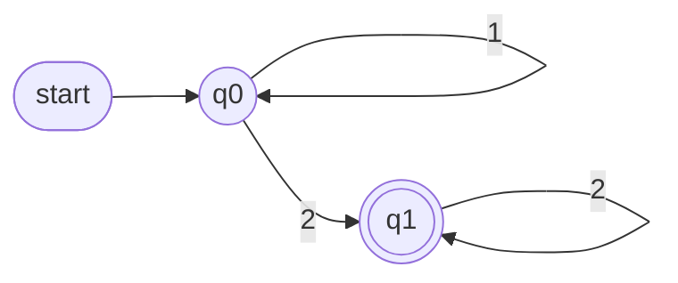
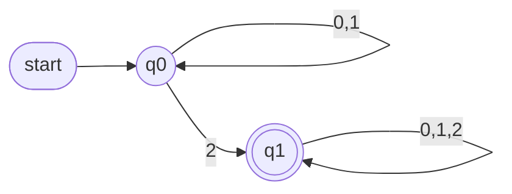
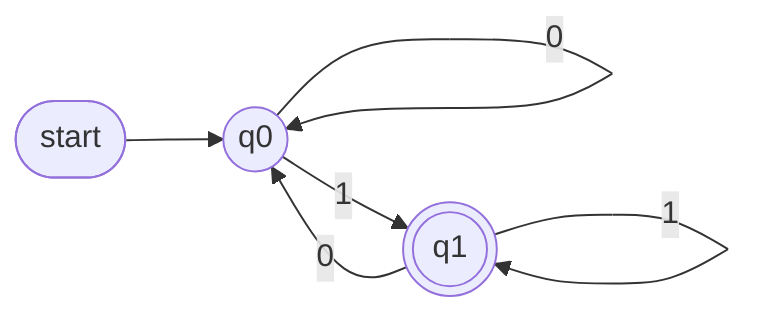
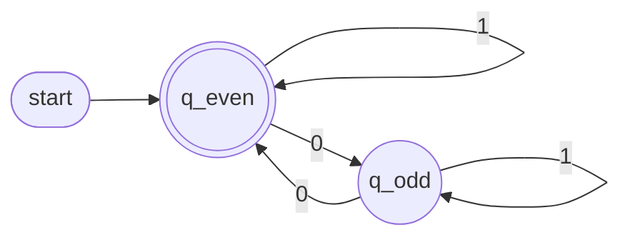
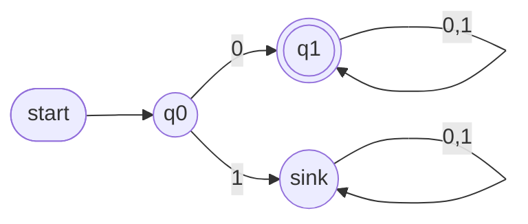
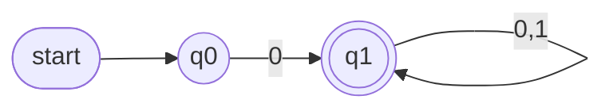
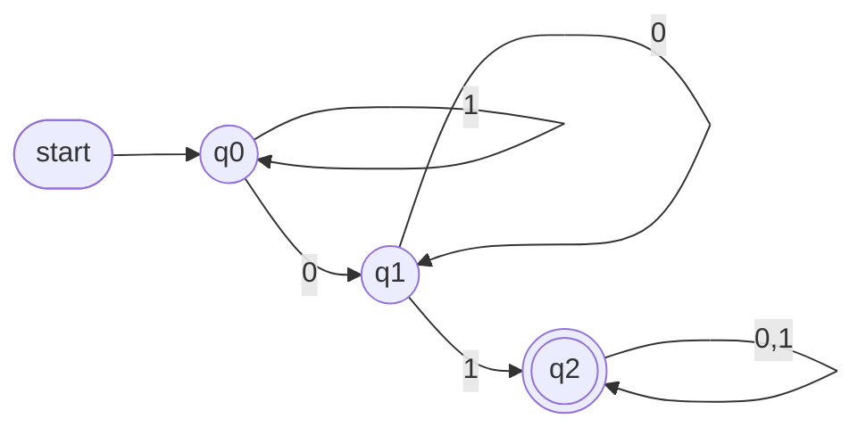
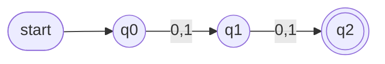
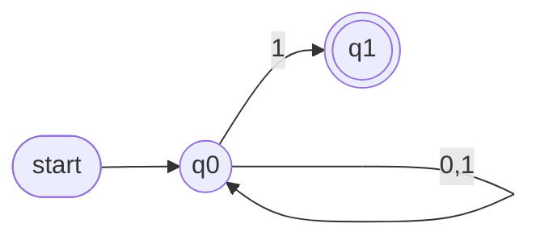

# Complexity Theory — Lecture 1: Deterministic Finite Automata (DFA)

> Lecture notes (in progress, more to be added)

---

## 1. Basic Concepts

### Alphabet (Σ)

A **finite set of symbols** used to build inputs.

- Example: `Σ = {0, 1}`

### String

A **finite sequence of symbols** from the alphabet.

- Examples over `Σ = {0, 1}`: `0`, `1`, `0110`, `111000`
- **ε (empty string):** the string with zero symbols (length 0).
- **Σ\***: the set of **all** possible strings over Σ (including ε). See below.

### Powers of an Alphabet (Σᵏ)

**Σᵏ** = the set of all strings of **length exactly k** over Σ.

For `Σ = {0, 1}`:

| Set | Strings of length | Contents                                 |
| --- | ----------------- | ---------------------------------------- |
| Σ⁰  | 0                 | {ε}                                      |
| Σ¹  | 1                 | {0, 1}                                   |
| Σ²  | 2                 | {00, 01, 10, 11}                         |
| Σ³  | 3                 | {000, 001, 010, 011, 100, 101, 110, 111} |

> In general, |Σᵏ| = |Σ|ᵏ. For Σ = {0,1} that gives 2ᵏ strings of length k.

### Sigma Closure / Kleene Star (Σ\*)

**Σ\*** is the union of strings of **every length** combined:

```
Σ* = Σ⁰ ∪ Σ¹ ∪ Σ² ∪ Σ³ ∪ ...      where Σ⁰ = {ε}
```

- Σ\* is **infinite**, but every string in it is **finite**.
- **Σ⁺** (Kleene plus) = Σ¹ ∪ Σ² ∪ Σ³ ∪ ... = Σ\* − {ε} (all **non-empty** strings).

> ⚠️ **{ε} ≠ ∅ (phi)**
>
> - `∅` is the empty set: it contains **nothing**.
> - `{ε}` is a set with **one** element, the empty string.
> - So Σ⁰ = {ε}, **not** ∅.

### Language

A **set of strings** over an alphabet, so it is always a subset of Σ\*.

- The language of a DFA `M`, written **L(M)**, is the set of all strings that `M` **accepts**.

---

## 2. What is a DFA?

A **Deterministic Finite Automaton** is a machine with a finite number of **states**. It reads an input string **one symbol at a time** and moves between states according to its **transitions**.

A DFA has:

| Component         | Meaning                                                                                       |
| ----------------- | --------------------------------------------------------------------------------------------- |
| **States**        | A finite set of states (drawn as circles)                                                     |
| **Alphabet Σ**    | The symbols the machine can read                                                              |
| **Transitions**   | For each state and each symbol, exactly **one** next state (this is why it's _deterministic_) |
| **Start state**   | Exactly **one** state where reading begins (marked with an incoming arrow)                    |
| **Accept states** | One or more states that mean "accept" (drawn as **double circles**)                           |

### Formal Definition of a DFA

A **DFA** is a **5-tuple**:

```
M = (Q, Σ, δ, q₀, F)
```

| Symbol | Name                | Meaning                                                                                   |
| ------ | ------------------- | ----------------------------------------------------------------------------------------- |
| **Q**  | States              | A **finite** set of states                                                                |
| **Σ**  | Alphabet            | A **finite** set of input symbols                                                         |
| **δ**  | Transition function | `δ : Q × Σ → Q`. It takes a state and a symbol and returns **exactly one** next state     |
| **q₀** | Start state         | `q₀ ∈ Q`. There is exactly **one** start state                                            |
| **F**  | Accept states       | `F ⊆ Q`. A set of accept states; it can have one or more states, or even be empty |

- `δ(q, a) = p` means: "in state `q`, reading symbol `a`, move to state `p`."
- `δ` is a **total function**: it is defined for **every** pair (q, a). That is why a missing arrow means "go to the sink state".

#### Extended transition function (δ\*): processing a whole string

`δ*` applies `δ` repeatedly to run a **whole string**:

```
δ*(q, ε)  = q                   (reading nothing keeps you in the same state)
δ*(q, wa) = δ( δ*(q, w), a )    (read w first, then read the last symbol a)
```

#### Formal acceptance

- `M` **accepts** a string `w` ⟺ `δ*(q₀, w) ∈ F`
- **Language of M:**

```
L(M) = { w ∈ Σ* | δ*(q₀, w) ∈ F }
```

#### Example: the formal definition of Example 1 (strings ending in 1)

```
Q  = {q0, q1}
Σ  = {0, 1}
q₀ = q0
F  = {q1}
δ(q0, 0) = q0     δ(q0, 1) = q1
δ(q1, 0) = q0     δ(q1, 1) = q1
```

### Regular Languages

> **If you can build a DFA for a language, then that language is REGULAR.**

```
L is regular  ⟺  there exists a DFA M such that L(M) = L
```

- **To prove a language is regular:** construct a DFA that accepts exactly the strings in L and nothing else.
- So **every language in the examples below is regular**: strings ending in 1, even number of 0s, starting with 0, containing `01`, and `(0+1)(0+1)`.
- A DFA has **finite memory** (a finite number of states). A language that needs **unbounded counting** therefore has no DFA and is **not regular**.
  - Classic example (likely covered later): `{ 0ⁿ1ⁿ | n ≥ 0 }` (n zeros followed by the same number of ones) is **not regular**.

---

## 3. Accepting and Rejecting a String

1. Begin at the **start state**.
2. Read the string **symbol by symbol**, following the transition for each symbol.
3. When the string is fully read, check the **last state**:
   - If it is an **accept state**, the string is **ACCEPTED** ✅
   - **Otherwise**, the string is **REJECTED** ❌

> Only the **last** state matters. Passing through an accept state partway through the string does not count.

---

## 4. Example DFAs over Σ = {0, 1}

**Diagram key:** `start` arrow = start state · `((q))` = normal state · `(((q)))` = accept state (double circle)

### Notation: combining arrows

When **several symbols** go from the **same source** state to the **same destination** state, there are two ways to draw them:

- draw **one arrow per symbol**, or
- draw **a single arrow** with the symbols separated by commas.

Both mean exactly the same thing.

**Example:** Σ = {0, 1, 2}, L = { w | w contains at least one `2` }

**(a) Separate arrows**, one per symbol:



**(b) Combined arrows**, which is the same DFA drawn more cleanly:



| State | 0   | 1   | 2   |
| ----- | --- | --- | --- |
| → q0  | q0  | q0  | q1  |
| \* q1 | q1  | q1  | q1  |

> The `0,1,2` label on `q1` stands for **three** transitions, not one. The DFA rule still holds: each state has exactly one transition for **each** symbol.

---

### Example 1: Strings that **end with 1**

L = { w ∈ {0,1}\* | w ends with 1 }



**Transition table** (`→` = start, `*` = accept):

| State | 0   | 1   |
| ----- | --- | --- |
| → q0  | q0  | q1  |
| \* q1 | q0  | q1  |

**Traces:**

- `0101`: q0 →0→ q0 →1→ q1 →0→ q0 →1→ **q1** ✅ Accepted
- `110`: q0 →1→ q1 →1→ q1 →0→ **q0** ❌ Rejected

---

### Example 2: Strings with an **even number of 0s**

L = { w ∈ {0,1}\* | w contains an even number of 0s }



| State       | 0      | 1      |
| ----------- | ------ | ------ |
| → \* q_even | q_odd  | q_even |
| q_odd       | q_even | q_odd  |

> The start state can also be an accept state. Here ε (zero 0s, which is even) is **accepted**.

**Traces:**

- `1001`: q_even →1→ q_even →0→ q_odd →0→ q_even →1→ **q_even** ✅ Accepted
- `0111`: q_even →0→ q_odd →1→ q_odd →1→ q_odd →1→ **q_odd** ❌ Rejected

---

### Example 3: Strings that **start with 0**

L = { w ∈ {0,1}\* | w starts with 0 }



| State  | 0      | 1      |
| ------ | ------ | ------ |
| → q0   | q1     | sink |
| \* q1  | q1     | q1     |
| sink | sink | sink |

> **Sink state:** every state in a DFA needs a transition for **every** symbol. Once the string starts with `1` it can never be accepted, so it goes to a sink state it never leaves. A sink state is **never** an accept state.

#### Drawing the sink state is optional

The sink state **may be drawn, or it may be left out**. If a diagram has **no transition** for some symbol from some state, assume that transition goes to a **hidden sink state**, which means the string is **rejected**.

The same DFA as above, **without** drawing the sink state:



> Here `q0` has no transition on `1`. That is not an error: reading `1` from `q0` goes to the **hidden sink state**, so the string is rejected.

**Traces:**

- `011`: q0 →0→ q1 →1→ q1 →1→ **q1** ✅ Accepted
- `100`: q0 →1→ sink →0→ sink →0→ **sink** ❌ Rejected

---

### Example 4: Strings that **contain the substring `01`**

L = { w ∈ {0,1}\* | w contains 01 }



| State | 0   | 1   |
| ----- | --- | --- |
| → q0  | q1  | q0  |
| q1    | q1  | q2  |
| \* q2 | q2  | q2  |

- `q0`: no progress yet
- `q1`: just saw a `0`
- `q2`: found `01`, and stays accepted from here on

**Traces:**

- `1101`: q0 →1→ q0 →1→ q0 →0→ q1 →1→ **q2** ✅ Accepted
- `1100`: q0 →1→ q0 →1→ q0 →0→ q1 →0→ **q1** ❌ Rejected

---

## 5. From a Regular Expression to a DFA

### Reading the regular expression `(0+1)(0+1)`

| Symbol                            | Meaning                                          |
| --------------------------------- | ------------------------------------------------ |
| `+`                               | **OR** (union): `0+1` means "a `0` **or** a `1`" |
| writing things next to each other | **concatenation** ("followed by")                |

So:

- `(0+1)` = **exactly one** symbol, either 0 or 1.
- `(0+1)(0+1)` = one symbol **followed by** another symbol = **any string of length exactly 2**.

```
L = { 00, 01, 10, 11 } = Σ²
```

### Building the DFA: count the symbols read

We only need to remember **how many symbols we have read so far**:

| State       | Meaning               |
| ----------- | --------------------- |
| q0 (start)  | read **0** symbols    |
| q1          | read **1** symbol     |
| q2 (accept) | read **2** symbols ✅ |



**Why 3 states and 6 transitions?**

- **3 states:** q0, q1, q2.
- **6 transitions:** in a DFA, **every state has one transition for every symbol**:

```
number of transitions = |states| × |Σ| = 3 × 2 = 6
```

| State | 0    | 1    |
| ----- | ---- | ---- |
| → q0  | q1   | q1   |
| q1    | q2   | q2   |
| \* q2 | sink | sink |

- 4 transitions are **drawn**: q0→q1 on 0 and on 1, and q1→q2 on 0 and on 1.
- 2 transitions are **not drawn**: from q2 on `0` and on `1`. After 2 symbols, any extra symbol makes the string too long, so these go to the **hidden sink state** (rejected). See Section 4.

> If the sink state is drawn explicitly, the DFA has **4 states × 2 symbols = 8 transitions**, because the sink also loops on 0 and 1.

**Traces:**

- `10`: q0 →1→ q1 →0→ **q2** ✅ Accepted (length 2)
- `1`: q0 →1→ **q1** ❌ Rejected (too short, q1 is not an accept state)
- `011`: q0 →0→ q1 →1→ q2 →1→ **sink** ❌ Rejected (too long)

---

## 6. Deterministic vs Non-Deterministic (DFA vs NFA)

The difference is **how many next states** a transition can lead to.

|                                       | **DFA** (Deterministic)                     | **NFA** (Non-Deterministic)                            |
| ------------------------------------- | ------------------------------------------- | ------------------------------------------------------ |
| Next state for a (state, symbol) pair | **Exactly 1**: only one option              | **0, 1, or more**: several options are possible        |
| Transition function                   | δ(q, a) = **one state**                     | δ(q, a) = **a set of states**                          |
| Missing transitions                   | Not allowed (they go to a sink state)       | Allowed: that path just dies                           |
| Accepts a string when                 | **The** single path ends in an accept state | **At least one** possible path ends in an accept state |

### Example: strings that **end with 1**, as an NFA

Compare this with the DFA in **Example 1**.



| State | 0    | 1                        |
| ----- | ---- | ------------------------ |
| → q0  | {q0} | **{q0, q1}** ← 2 choices |
| \* q1 | ∅    | ∅                        |

- From `q0` on input `1`, the machine can **either** stay in `q0` **or** move to `q1`, so it is **not deterministic**.
- `q1` has no outgoing transitions (∅). Any path that reads a symbol from `q1` simply dies.

**Trace of `101`.** Follow all possible paths:

- q0 →1→ q0 →0→ q0 →1→ **q1** ✅ (this path accepts)
- q0 →1→ q0 →0→ q0 →1→ q0 ❌
- q0 →1→ q1 →0→ (path dies, no 0-arrow) ❌

Since **at least one** path ends in an accept state, `101` is **Accepted**.

> Every DFA is also an NFA, because "exactly one choice" is a special case of "any number of choices".

---

## 7. Summary

- **Alphabet** → symbols; **strings** → finite sequences of symbols; **language** → a set of strings.
- A **DFA** has states, one start state, accept states, and exactly one transition per (state, symbol).
- A string is **accepted** if, starting from the start state, it **ends in an accept state**. Otherwise it is **rejected**.
- **L(M)** = the set of all strings the DFA accepts.
- **If a DFA can be built for a language, the language is regular.**
- A **sink state** catches strings that can never be accepted. It can be drawn or omitted. A missing transition means "go to the sink state", so the string is rejected.
- **DFA:** each (state, symbol) has **exactly one** next state. **NFA:** it can have **more than one** (or none), and the NFA accepts if **any** path reaches an accept state.

---

_(To be continued...)_
