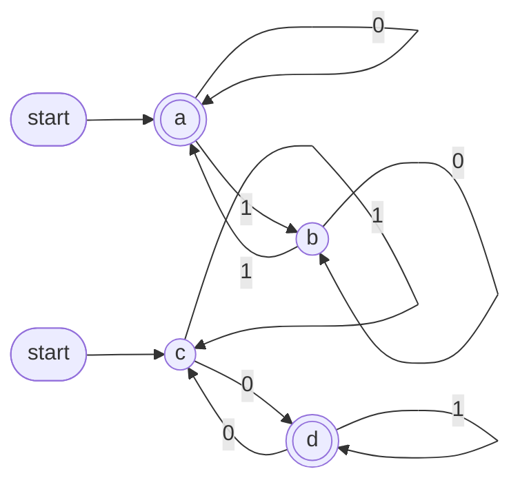

# Complexity Theory — Lecture 2: Operations on Regular Languages

> ⚠️ Some parts were written **ahead of the lecture**. Check them against the doctor's version.

---

## 0. Terminology (used everywhere in these notes)

| Term | Meaning |
|---|---|
| **Σ** (alphabet) | The input symbols. Here, Σ = {0, 1} |
| **ε** | The empty string (length 0) |
| **Σ\*** | All strings over Σ, including ε |
| **Language** | A set of strings, i.e. a subset of Σ\* |
| **Regular language** | A language that has a DFA |
| **M_A, M_B** | The DFAs for languages A and B |
| **Start state** | Where reading begins (marked with an incoming arrow) |
| **Accept state** | If the string ends here, it is accepted ✅ (drawn as a double circle) |
| **Sink state** | A non-accept state you can never leave. It may be hidden (not drawn) |
| **Combined state** | A pair (state of M_A, state of M_B), used in union and intersection |
| **Closed under X** | Applying X to regular languages gives a regular language |

---

## 1. The Operations

Let A and B be languages over Σ.

| Operation | Notation | Definition | In words |
|---|---|---|---|
| Union | A ∪ B | { w \| w ∈ A **or** w ∈ B } | in A, in B, or in both |
| Intersection | A ∩ B | { w \| w ∈ A **and** w ∈ B } | in both |
| Complement ("not A") | Ā | { w ∈ Σ\* \| w ∉ A } | everything **not** in A |
| Concatenation | A ∘ B | { xy \| x ∈ A, y ∈ B } | a string from A, **then** a string from B |
| Star (closure) | A\* | A⁰ ∪ A¹ ∪ A² ∪ … (A⁰ = {ε}) | glue together **0 or more** strings from A |

**Quick example.** A = {0, 11}, B = {11, 00}

| A ∪ B | A ∩ B | A ∘ B | B ∘ A |
|---|---|---|---|
| {0, 11, 00} | {11} | {011, 000, 1111, 1100} | {110, 1111, 000, 0011} |

### A ∘ B ≠ B ∘ A
**Order matters** in concatenation. Above, `011` ∈ A ∘ B but `011` ∉ B ∘ A.
(Union and intersection *are* order-free: A ∪ B = B ∪ A.)

### Star: every string that can be generated from A
**Example (from the lecture):** A = {010, 0011, 110101}

| Pieces | Strings in A\* |
|---|---|
| 0 | ε (**always** in A\*) |
| 1 | 010, 0011, 110101 |
| 2 | 010010, 0100011, 010110101, 0011010, 00110011, … |
| 3 | 0100011110101, 010010010, … |

- To check whether w ∈ A\*, **split w into pieces from A**. Example: `0011010` = `0011`·`010` ✅
- `0101` ∉ A\*, because no split of it uses only pieces from A.
- Σ\* from Lecture 1 is just the star of the alphabet.

---

## 2. The Big Idea: Closure

> 📌 If A and B are regular, then **Ā, A ∪ B, A ∩ B, A ∘ B, and A\*** are **all regular**.

**How to prove it:** build a DFA for the result. If a DFA exists, the language is regular.

| Operation | Technique | Section |
|---|---|---|
| Complement | Flip the accept states | 3 |
| Union | Combined states (Cartesian product), accept with OR | 4 |
| Intersection | Same as union, accept with AND | 5 |
| Concatenation, Star | Need an **NFA** | 6 |

---

## 3. Complement (Ā)

> 📌 **Rule:** take the DFA and **flip the accept states**. Accept becomes non-accept, and non-accept becomes accept.
> Nothing else changes, so the result is still a DFA, which means **Ā is regular**.

### ⚠️ Draw the sink state first!
A hidden sink must **also** be flipped, so you have to draw it before flipping.

**How do I find a hidden sink?** With Σ = {0, 1}, **every state needs one 0-arrow and one 1-arrow**.
If any state is **missing** an arrow, there is a hidden sink. Draw it, send the missing arrows to it, and give it a `0,1` self-loop.

### Example (from the lecture): Ā where A = Σ² = {00, 01, 10, 11}
Ā = Σ\* − Σ² = every string whose **length is not 2**.

**Step 1: draw the DFA for Σ² with the sink.** It has 3 nodes connected by `0,1` arrows, and the last `0,1` arrow goes to the sink.


**Step 2: flip the accept states.**


| State | Length read | Σ² | **Ā** |
|---|---|---|---|
| → q0 | 0 | ❌ | ✅ |
| q1 | 1 | ❌ | ✅ |
| q2 | 2 | ✅ | ❌ |
| sink | ≥ 3 | ❌ | ✅ |

**Check:** `1` ✅ · `01` ❌ · `101` ✅ (it reaches the sink, which is now accepting)

> If the sink had stayed hidden, `101` would be rejected, which is wrong.
> Flipping works for **DFAs only**, not NFAs.

---

## 4. Union (A ∪ B): Combined States

> 📌 **Rule:** the union of any two regular languages is regular. There is a fixed technique for building its DFA.

### What is the Cartesian product (×)?
Pair **every** element of the first set with **every** element of the second set:
X × Y = { (x, y) | x ∈ X, y ∈ Y }, and the size is |X| × |Y|.

Example: {1, 2, 3} × {p, q} = {(1,p), (1,q), (2,p), (2,q), (3,p), (3,q)}, which has **3 × 2 = 6** pairs.

### The technique
1. Draw **M_A** and **M_B**.
2. **Combined states** = (states of M_A) × (states of M_B). Draw them as a **box**.
3. **Start** = (start of M_A, start of M_B).
4. **Connect** each combined state: for each symbol, M_A and M_B **each move on their own**, and the arrow lands on the resulting combined state.
5. **Accept:** a combined state is accepting if it contains **any** accept state (**OR**).
6. **Verify** some strings.

> **Why pairs?** The new DFA must remember where M_A is **and** where M_B is at the same time.

### Example (from the lecture)
Σ = {0, 1}, **A = even number of 1s**, **B = odd number of 0s**

```
A       = { ε, 0, 00, 11, 000, 011, 101, 110, ... }
B       = { 0, 01, 10, 000, 011, 101, 110, ... }
A ∪ B   = { ε, 0, 00, 01, 10, 11, 000, 011, ... }
        = any string with even 1s OR odd 0s
```

**Step 1: M_A and M_B**

| M_A (even 1s) | M_B (odd 0s) |
|---|---|
| **a** = even 1s (start, accept ✅) | **c** = even 0s (start) |
| **b** = odd 1s | **d** = odd 0s (accept ✅) |
| a `1` switches a ↔ b, a `0` stays | a `0` switches c ↔ d, a `1` stays |



**Steps 2, 3 and 5: the box** (2 × 2 = 4 combined states)

```
                          c (even 0s)     d (odd 0s)
                        ┌──────────────┬──────────────┐
 start ──▶ a (even 1s)  │ ▶(a,c)  ✅   │  (a,d)  ✅   │
                        ├──────────────┼──────────────┤
           b (odd 1s)   │  (b,c)  ❌   │  (b,d)  ✅   │
                        └──────────────┴──────────────┘
```

Accepting = contains **a OR d**. The only reject is **(b,c)**, which means odd 1s **and** even 0s.

**Step 4: connect each combined state**

| Combined state | on 0 (M_B moves) | on 1 (M_A moves) | Accept? |
|---|---|---|---|
| → (a,c) | (a,d) | (b,c) | ✅ |
| (a,d) | (a,c) | (b,d) | ✅ |
| (b,c) | (b,d) | (a,c) | ❌ |
| (b,d) | (b,c) | (a,d) | ✅ |

```
        start
          ▼
     ┌───────┐ ──0──▶ ┌───────┐
     │ (a,c) │        │ (a,d) │        on the box:
     │  ✅   │ ◀──0── │  ✅   │        0 moves left ↔ right
     └───────┘        └───────┘        1 moves up ↕ down
       ▲   │            ▲   │
       1   1            1   1
       │   ▼            │   ▼
     ┌───────┐ ──0──▶ ┌───────┐
     │ (b,c) │        │ (b,d) │
     │  ❌   │ ◀──0── │  ✅   │
     └───────┘        └───────┘
```

Every combined state has exactly one 0-arrow and one 1-arrow, so this is a valid DFA (4 × 2 = 8 transitions).

**Step 6: verify**

| String | Path | Ends at | DFA | # 1s / # 0s | Expected |
|---|---|---|---|---|---|
| ε | (a,c) | (a,c) | ✅ | 0 / 0 | even 1s ✅ |
| `1` | (a,c)→(b,c) | (b,c) | ❌ | 1 / 0 | neither ❌ |
| `10` | (a,c)→(b,c)→(b,d) | (b,d) | ✅ | 1 / 1 | odd 0s ✅ |
| `100` | (a,c)→(b,c)→(b,d)→(b,c) | (b,c) | ❌ | 1 / 2 | neither ❌ |
| `0101` | (a,c)→(a,d)→(b,d)→(b,c)→(a,c) | (a,c) | ✅ | 2 / 2 | even 1s ✅ |

All rows match ✔️

> **Tip:** the combined state tells you the counts so far. For example, (b,d) means odd 1s and odd 0s.

---

## 5. Intersection (A ∩ B)

> 📌 **The same box and the same arrows as the union.** Only the accept rule changes: a combined state is accepting if **both** parts are accept states (**AND**).

In the example above, A ∩ B = even 1s **and** odd 0s, so the only accept state is **(a,d)**.

| Operation | Combined state (x, y) is accepting when |
|---|---|
| A ∪ B | x accepts **OR** y accepts |
| A ∩ B | x accepts **AND** y accepts |

---

## 6. Concatenation & Star: the NFA

> 📌 **To talk about concatenation and star (closure), we first need the NFA.**

**Why a DFA isn't enough:** for A ∘ B, the string has to be **split** into an A-part and a B-part, and a DFA doesn't know **where** to split.
For example, with A = {0, 01} and B = {1, 11}, the string `011` can be split as `0|11` or as `01|1`.
An **NFA** can try all splits at once, because it can have more than one next state (Lecture 1, Section 6).

*(NFA details will be added as the lecture continues.)*

<details><summary>Preview: the standard NFA constructions</summary>

The constructions use **ε-arrows**, which move to another state without reading a symbol.

- **A ∘ B:** add ε-arrows from M_A's accept states to M_B's start. Only M_B's accept states stay accepting.
- **A\*:** add a new start state that is also accepting (so ε is accepted), plus ε-arrows from A's accept states back to A's start.
- Every NFA can be converted into a DFA, so the results are still **regular**.

</details>

---

## 7. Summary

| Operation | Technique | # states |
|---|---|---|
| Ā | Flip the accept states (**draw the sink first!**) | same |
| A ∪ B | Box of combined states, accept with **OR** | \|M_A\| × \|M_B\| |
| A ∩ B | The same box, accept with **AND** | \|M_A\| × \|M_B\| |
| A ∘ B, A\* | NFA | — |

- Regular languages are **closed** under all of these operations.
- A ∘ B ≠ B ∘ A. ε is always in A\*.

---

## 8. Practice

**Q1.** A = {1, 01}, B = {0, 1}. Find A ∘ B and A ∩ B.
<details><summary>Answer</summary>A ∘ B = {10, 11, 010, 011}, A ∩ B = {1}</details>

**Q2.** List 3 strings of {01}\*.
<details><summary>Answer</summary>ε, 01, 0101</details>

**Q3.** M_A has 3 states and M_B has 4. How many combined states does the union DFA have?
<details><summary>Answer</summary>3 × 4 = 12</details>

**Q4.** In the Section 4 example, is `110` in A ∪ B? Is it in A ∩ B?
<details><summary>Answer</summary>(a,c) →1→ (b,c) →1→ (a,c) →0→ (a,d). That is ✅ in A ∪ B, and ✅ in A ∩ B too, since `110` has two 1s (even) and one 0 (odd).</details>

**Q5.** Complement the DFA "contains `01`" (Lecture 1, Example 4). Is a sink needed?
<details><summary>Answer</summary>No, every state already has both arrows. Flip the states: q0 and q1 accept, q2 doesn't. The result is the strings with no `01`, i.e. some 1s followed by some 0s.</details>

---

*(To be continued...)*
