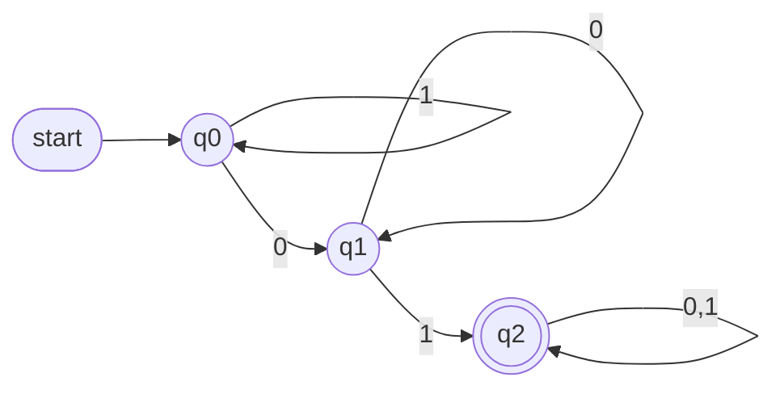
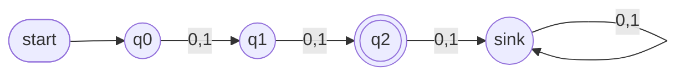
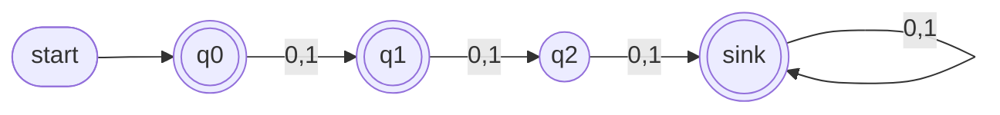
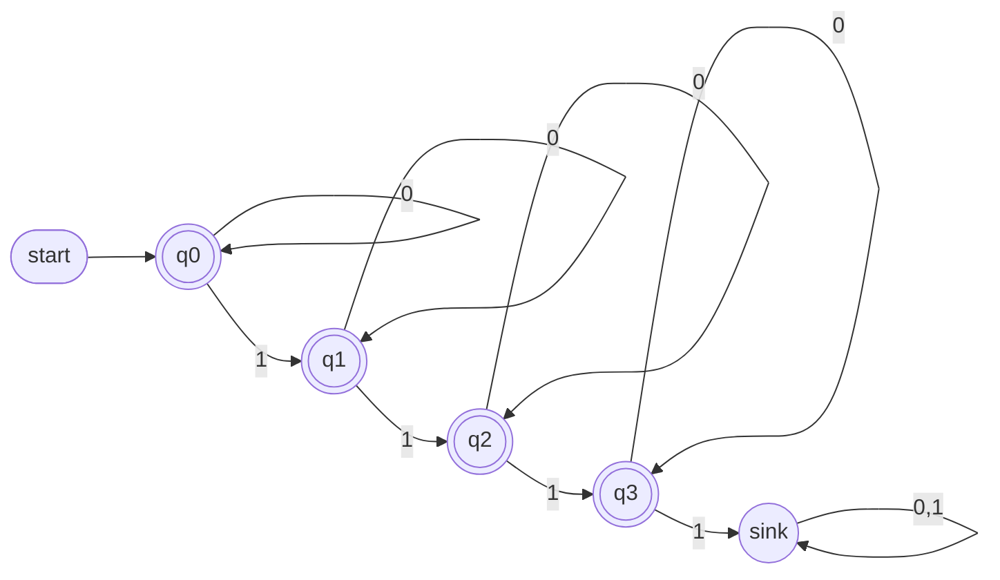
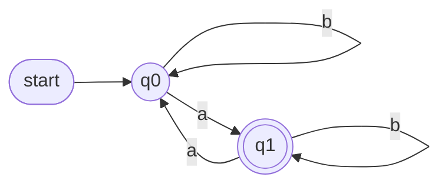
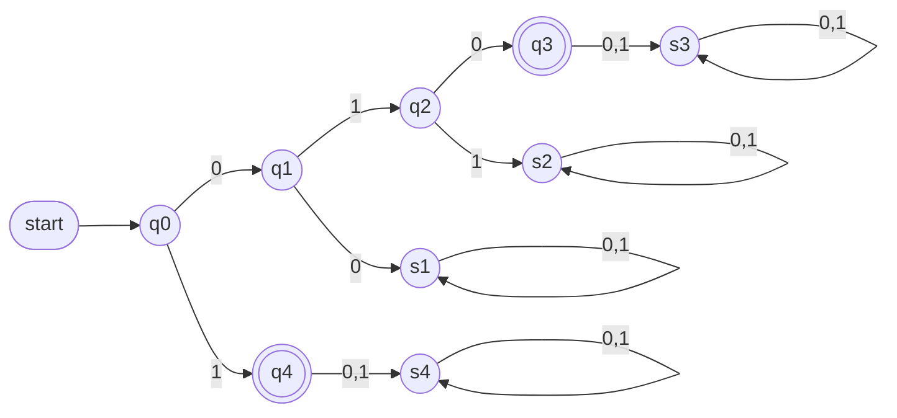
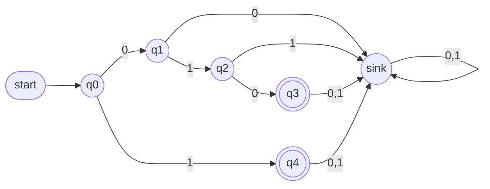
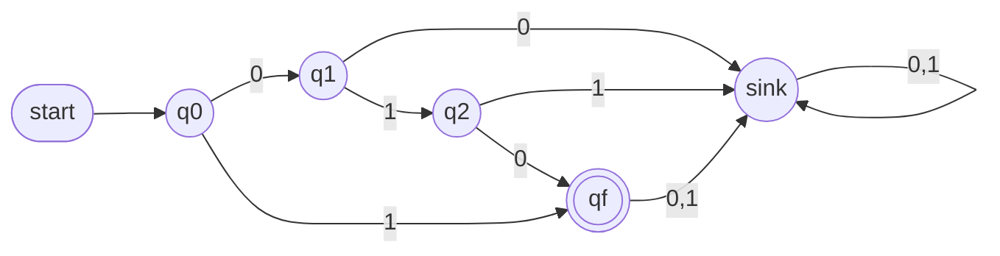
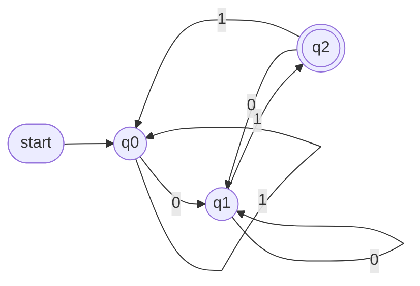
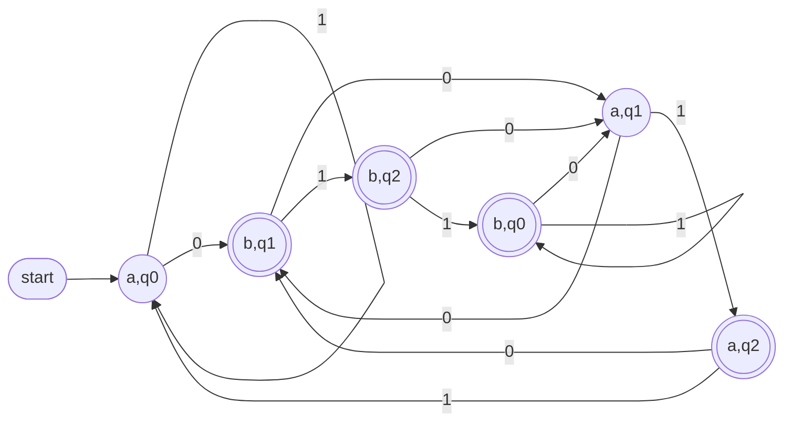

# Complexity Theory — Lecture 2: Operations on Regular Languages

> ⚠️ The NFA preview in Section 6 was written **ahead of the lecture** and will be covered properly in a later lecture.

---

## 0. Terminology (used everywhere in these notes)

| Term | Meaning |
|---|---|
| **Σ** (alphabet) | The input symbols. Here, Σ = {0, 1} |
| **ε** | The empty string (length 0) |
| **Σ\*** | All strings over Σ, including ε |
| **Language** | A set of strings, i.e. a subset of Σ\* |
| **Regular language** | A language that has a DFA |
| **M_A, M_B** | The DFAs for languages A and B |
| **Start state** | Where reading begins (marked with an incoming arrow) |
| **Accept state** | If the string ends here, it is accepted ✅ (drawn as a double circle) |
| **Sink state** | A non-accept state you can never leave. It may be hidden (not drawn) |
| **Combined state** | A pair (state of M_A, state of M_B), used in union and intersection |
| **Closed under X** | Applying X to regular languages gives a regular language |

### The transition function δ as a table
The transition function can be written as a **table**, similar to a **truth table**:
- **rows** = the states (q0, q1, q2)
- **columns** = the symbols of Σ (0, 1)
- **each cell** = δ(state, symbol), i.e. the next state

**Example:** "contains `01`" (Lecture 1, Example 4), with Q = {q0, q1, q2} and Σ = {0, 1}

| δ | **0** | **1** |
|---|---|---|
| → q0 | q1 | q0 |
| q1 | q1 | q2 |
| \* q2 | q2 | q2 |

Read the cells as δ(q0, 0) = q1, δ(q0, 1) = q0, δ(q1, 1) = q2, and so on.



- `→` marks the start state and `*` marks an accept state.
- **Table size** = |Q| rows × |Σ| columns = 3 × 2 = **6 cells = 6 transitions**.
- In a DFA, **every cell holds exactly one state**. An empty cell would mean a hidden sink.
- The table and the diagram show **the same DFA**. Use whichever is easier.

---

## 1. The Operations

Let A and B be languages over Σ.

| Operation | Notation | Definition | In words |
|---|---|---|---|
| Union | A ∪ B | { w \| w ∈ A **or** w ∈ B } | in A, in B, or in both |
| Intersection | A ∩ B | { w \| w ∈ A **and** w ∈ B } | in both |
| Complement ("not A") | Ā | { w ∈ Σ\* \| w ∉ A } | everything **not** in A |
| Concatenation | A ∘ B | { xy \| x ∈ A, y ∈ B } | a string from A, **then** a string from B |
| Star (closure) | A\* | A⁰ ∪ A¹ ∪ A² ∪ … (A⁰ = {ε}) | glue together **0 or more** strings from A |

**Quick example.** A = {0, 11}, B = {11, 00}

| A ∪ B | A ∩ B | A ∘ B | B ∘ A |
|---|---|---|---|
| {0, 11, 00} | {11} | {011, 000, 1111, 1100} | {110, 1111, 000, 0011} |

### A ∘ B ≠ B ∘ A
**Order matters** in concatenation. Above, `011` ∈ A ∘ B but `011` ∉ B ∘ A.
(Union and intersection *are* order-free: A ∪ B = B ∪ A.)

### Star: every string that can be generated from A
**Example (from the lecture):** A = {010, 0011, 110101}

| Pieces | Strings in A\* |
|---|---|
| 0 | ε (**always** in A\*) |
| 1 | 010, 0011, 110101 |
| 2 | 010010, 0100011, 010110101, 0011010, 00110011, … |
| 3 | 0100011110101, 010010010, … |

- To check whether w ∈ A\*, **split w into pieces from A**. Example: `0011010` = `0011`·`010` ✅
- `0101` ∉ A\*, because no split of it uses only pieces from A.
- Σ\* from Lecture 1 is just the star of the alphabet.

---

## 2. The Big Idea: Closure

> 📌 If A and B are regular, then **Ā, A ∪ B, A ∩ B, A ∘ B, and A\*** are **all regular**.

**How to prove it:** build a DFA for the result. If a DFA exists, the language is regular.

| Operation | Technique | Section |
|---|---|---|
| Complement | Flip the accept states | 3 |
| Union | Combined states (Cartesian product), accept with OR | 4 |
| Intersection | Same as union, accept with AND | 5 |
| Concatenation, Star | Need an **NFA** | 6 |

---

## 3. Complement (Ā)

> 📌 **Rule:** take the DFA and **flip the accept states**. Accept becomes non-accept, and non-accept becomes accept.
> Nothing else changes, so the result is still a DFA, which means **Ā is regular**.

### ⚠️ Draw the sink state first!
A hidden sink must **also** be flipped, so you have to draw it before flipping.

**How do I find a hidden sink?** With Σ = {0, 1}, **every state needs one 0-arrow and one 1-arrow**.
If any state is **missing** an arrow, there is a hidden sink. Draw it, send the missing arrows to it, and give it a `0,1` self-loop.

### Example (from the lecture): Ā where A = Σ² = {00, 01, 10, 11}
Ā = Σ\* − Σ² = every string whose **length is not 2**.

**Step 1: draw the DFA for Σ² with the sink.** It has 3 nodes connected by `0,1` arrows, and the last `0,1` arrow goes to the sink.



**Step 2: flip the accept states.**



| State | Length read | Σ² | **Ā** |
|---|---|---|---|
| → q0 | 0 | ❌ | ✅ |
| q1 | 1 | ❌ | ✅ |
| q2 | 2 | ✅ | ❌ |
| sink | ≥ 3 | ❌ | ✅ |

**Check:** `1` ✅ · `01` ❌ · `101` ✅ (it reaches the sink, which is now accepting)

> If the sink had stayed hidden, `101` would be rejected, which is wrong.
> Flipping works for **DFAs only**, not NFAs.

---

## 4. Union (A ∪ B): Combined States

> 📌 **Rule:** the union of any two regular languages is regular. There is a fixed technique for building its DFA.

### What is the Cartesian product (×)?
Pair **every** element of the first set with **every** element of the second set:
X × Y = { (x, y) | x ∈ X, y ∈ Y }, and the size is |X| × |Y|.

Example: {1, 2, 3} × {p, q} = {(1,p), (1,q), (2,p), (2,q), (3,p), (3,q)}, which has **3 × 2 = 6** pairs.

### The technique
1. Draw **M_A** and **M_B**.
2. **Combined states** = (states of M_A) × (states of M_B). Draw them as a **box**.
3. **Start** = (start of M_A, start of M_B).
4. **Connect** each combined state: for each symbol, M_A and M_B **each move on their own**, and the arrow lands on the resulting combined state.
5. **Accept:** a combined state is accepting if it contains **any** accept state (**OR**).
6. **Verify** some strings.

> **Why pairs?** The new DFA must remember where M_A is **and** where M_B is at the same time.

### Example (from the lecture)
Σ = {0, 1}, **A = even number of 1s**, **B = odd number of 0s**

```
A       = { ε, 0, 00, 11, 000, 011, 101, 110, ... }
B       = { 0, 01, 10, 000, 011, 101, 110, ... }
A ∪ B   = { ε, 0, 00, 01, 10, 11, 000, 011, ... }
        = any string with even 1s OR odd 0s
```

**Step 1: M_A and M_B**

| M_A (even 1s) | M_B (odd 0s) |
|---|---|
| **a** = even 1s (start, accept ✅) | **c** = even 0s (start) |
| **b** = odd 1s | **d** = odd 0s (accept ✅) |
| a `1` switches a ↔ b, a `0` stays | a `0` switches c ↔ d, a `1` stays |


**Steps 2, 3 and 5: the box** (2 × 2 = 4 combined states)

```
                          c (even 0s)     d (odd 0s)
                        ┌──────────────┬──────────────┐
 start ──▶ a (even 1s)  │ ▶(a,c)  ✅   │  (a,d)  ✅   │
                        ├──────────────┼──────────────┤
           b (odd 1s)   │  (b,c)  ❌   │  (b,d)  ✅   │
                        └──────────────┴──────────────┘
```

Accepting = contains **a OR d**. The only reject is **(b,c)**, which means odd 1s **and** even 0s.

**Step 4: connect each combined state**

| Combined state | on 0 (M_B moves) | on 1 (M_A moves) | Accept? |
|---|---|---|---|
| → (a,c) | (a,d) | (b,c) | ✅ |
| (a,d) | (a,c) | (b,d) | ✅ |
| (b,c) | (b,d) | (a,c) | ❌ |
| (b,d) | (b,c) | (a,d) | ✅ |

```
        start
          ▼
     ┌───────┐ ──0──▶ ┌───────┐
     │ (a,c) │        │ (a,d) │        on the box:
     │  ✅   │ ◀──0── │  ✅   │        0 moves left ↔ right
     └───────┘        └───────┘        1 moves up ↕ down
       ▲   │            ▲   │
       1   1            1   1
       │   ▼            │   ▼
     ┌───────┐ ──0──▶ ┌───────┐
     │ (b,c) │        │ (b,d) │
     │  ❌   │ ◀──0── │  ✅   │
     └───────┘        └───────┘
```

Every combined state has exactly one 0-arrow and one 1-arrow, so this is a valid DFA (4 × 2 = 8 transitions).

**Step 6: verify**

| String | Path | Ends at | DFA | # 1s / # 0s | Expected |
|---|---|---|---|---|---|
| ε | (a,c) | (a,c) | ✅ | 0 / 0 | even 1s ✅ |
| `1` | (a,c)→(b,c) | (b,c) | ❌ | 1 / 0 | neither ❌ |
| `10` | (a,c)→(b,c)→(b,d) | (b,d) | ✅ | 1 / 1 | odd 0s ✅ |
| `100` | (a,c)→(b,c)→(b,d)→(b,c) | (b,c) | ❌ | 1 / 2 | neither ❌ |
| `0101` | (a,c)→(a,d)→(b,d)→(b,c)→(a,c) | (a,c) | ✅ | 2 / 2 | even 1s ✅ |

All rows match ✔️

> **Tip:** the combined state tells you the counts so far. For example, (b,d) means odd 1s and odd 0s.

---

## 5. Intersection (A ∩ B)

> 📌 **The same box and the same arrows as the union.** Only the accept rule changes: a combined state is accepting if **both** parts are accept states (**AND**).

### Example (from the lecture): A ∩ B = even 1s **AND** odd 0s
Use the same A and B as in Section 4. A string is accepted **only if both** conditions hold: an **even number of 1s** and an **odd number of 0s**.

```
A ∩ B = { 0, 000, 011, 101, 110, 00000, ... }
```

**The box.** Same combined states and same arrows. The only accepting state is **(a,d)**, because it is the only one where both parts are accept states.

```
                          c (even 0s)     d (odd 0s)
                        ┌──────────────┬──────────────┐
 start ──▶ a (even 1s)  │ ▶(a,c)  ❌   │  (a,d)  ✅   │
                        ├──────────────┼──────────────┤
           b (odd 1s)   │  (b,c)  ❌   │  (b,d)  ❌   │
                        └──────────────┴──────────────┘
```

| Combined state | on 0 | on 1 | a accepts? | d accepts? | **∩ accepts?** |
|---|---|---|---|---|---|
| → (a,c) | (a,d) | (b,c) | ✅ | ❌ | ❌ |
| (a,d) | (a,c) | (b,d) | ✅ | ✅ | ✅ |
| (b,c) | (b,d) | (a,c) | ❌ | ❌ | ❌ |
| (b,d) | (b,c) | (a,d) | ❌ | ✅ | ❌ |

**Verify**

| String | Path | Ends at | DFA | # 1s / # 0s | Expected |
|---|---|---|---|---|---|
| ε | (a,c) | (a,c) | ❌ | 0 / 0 | even 0s ❌ |
| `0` | (a,c)→(a,d) | (a,d) | ✅ | 0 / 1 | both ✅ |
| `00` | (a,c)→(a,d)→(a,c) | (a,c) | ❌ | 0 / 2 | even 0s ❌ |
| `10` | (a,c)→(b,c)→(b,d) | (b,d) | ❌ | 1 / 1 | odd 1s ❌ |
| `110` | (a,c)→(b,c)→(a,c)→(a,d) | (a,d) | ✅ | 2 / 1 | both ✅ |
| `0110` | (a,c)→(a,d)→(b,d)→(a,d)→(a,c) | (a,c) | ❌ | 2 / 2 | even 0s ❌ |

All rows match ✔️

> **Observation:** even 1s + odd 0s always gives an **odd length**. So no string of even length is ever in A ∩ B (for example, ε, `00`, `10`, `0110`).

| Operation | Combined state (x, y) is accepting when |
|---|---|
| A ∪ B | x accepts **OR** y accepts |
| A ∩ B | x accepts **AND** y accepts |

---

## 6. Concatenation & Star: the NFA

> 📌 **To talk about concatenation and star (closure), we first need the NFA.**

**Why a DFA isn't enough:** for A ∘ B, the string has to be **split** into an A-part and a B-part, and a DFA doesn't know **where** to split.
For example, with A = {0, 01} and B = {1, 11}, the string `011` can be split as `0|11` or as `01|1`.
An **NFA** can try all splits at once, because it can have more than one next state (Lecture 1, Section 6).

*(NFA details will be added as the lecture continues.)*

<details><summary>Preview: the standard NFA constructions</summary>

The constructions use **ε-arrows**, which move to another state without reading a symbol.

- **A ∘ B:** add ε-arrows from M_A's accept states to M_B's start. Only M_B's accept states stay accepting.
- **A\*:** add a new start state that is also accepting (so ε is accepted), plus ε-arrows from A's accept states back to A's start.
- Every NFA can be converted into a DFA, so the results are still **regular**.

</details>

---

## 7. DFA Examples

### Example 1: strings with **at most three 1s**
Σ = {0, 1}, L = { w | w contains **at most three** 1s }, i.e. 0, 1, 2, or 3 ones

**Idea:** count the 1s. The `0`s don't matter, so each state loops on 0.

| State | Meaning | Accept? |
|---|---|---|
| q0 (start) | 0 ones so far | ✅ |
| q1 | 1 one | ✅ |
| q2 | 2 ones | ✅ |
| q3 | 3 ones | ✅ |
| sink | 4 or more ones, so it can never be fixed | ❌ |



**Transition table**

| δ | 0 | 1 |
|---|---|---|
| → \* q0 | q0 | q1 |
| \* q1 | q1 | q2 |
| \* q2 | q2 | q3 |
| \* q3 | q3 | sink |
| sink | sink | sink |

- **4 accept states** (q0 to q3) and **1 sink**: 5 states × 2 symbols = 10 transitions.
- The sink is drawn here. If it were hidden, q3 would have no 1-arrow.

**Verify**

| String | Path | # 1s | Result |
|---|---|---|---|
| ε | q0 | 0 | ✅ |
| `0000` | q0 → q0 → q0 → q0 → q0 | 0 | ✅ |
| `10101` | q0 → q1 → q1 → q2 → q2 → q3 | 3 | ✅ |
| `0110` | q0 → q0 → q1 → q2 → q2 | 2 | ✅ |
| `1111` | q0 → q1 → q2 → q3 → sink | 4 | ❌ |
| `110110` | q0 → q1 → q2 → q2 → q3 → sink → sink | 4 | ❌ |

> **Bonus (complement):** "at least four 1s" is the same DFA with the accept states flipped. Only the **sink** is accepting there, which is why the sink must be drawn.

### Example 2: L_A = strings with an **odd number of a's**
Σ = {a, b} (the alphabet doesn't have to be {0, 1}).

**Idea:** track whether the number of a's is even or odd. An `a` switches the state, and a `b` changes nothing.

| State | Meaning | Accept? |
|---|---|---|
| q0 (start) | even a's so far (zero a's is even) | ❌ |
| q1 | odd a's so far | ✅ |



| δ | a | b |
|---|---|---|
| → q0 | q1 | q0 |
| \* q1 | q0 | q1 |

- **No sink is needed:** every state already has an `a`-arrow and a `b`-arrow.
- 2 states × 2 symbols = 4 transitions.

**Verify**

| String | Path | # a's | Result |
|---|---|---|---|
| ε | q0 | 0 | ❌ |
| `a` | q0 → q1 | 1 | ✅ |
| `bab` | q0 → q0 → q1 → q1 | 1 | ✅ |
| `aba` | q0 → q1 → q1 → q0 | 2 | ❌ |
| `aaab` | q0 → q1 → q0 → q1 → q1 | 3 | ✅ |

> This is the same shape as M_B in Section 4 ("odd 0s"), with `a` in place of `0` and `b` in place of `1`.

### Example 3: a finite language, L = {010, 1}
Σ = {0, 1}. The DFA must accept **exactly two strings**, `010` and `1`, and reject **everything else**.

**Idea:** build a **path for each string**, one state per prefix read so far. Every "wrong" arrow goes to a sink.

#### Step 1: without sharing (a separate sink for every wrong arrow)

| State | Prefix read so far | Accept? |
|---|---|---|
| q0 (start) | ε | ❌ |
| q1 | `0` | ❌ |
| q2 | `01` | ❌ |
| q3 | `010` | ✅ |
| q4 | `1` | ✅ |
| s1, s2, s3, s4 | wrong symbol, so it can never be accepted | ❌ |



| δ | 0 | 1 |
|---|---|---|
| → q0 | q1 | q4 |
| q1 | s1 | q2 |
| q2 | q3 | s2 |
| \* q3 | s3 | s3 |
| \* q4 | s4 | s4 |
| s1 | s1 | s1 |
| s2 | s2 | s2 |
| s3 | s3 | s3 |
| s4 | s4 | s4 |

This version has **9 states** (18 transitions). It is correct, but large.

**Verify**

| String | Path | Result |
|---|---|---|
| `1` | q0 → q4 | ✅ |
| `010` | q0 → q1 → q2 → q3 | ✅ |
| ε | q0 | ❌ |
| `01` | q0 → q1 → q2 | ❌ (incomplete) |
| `11` | q0 → q4 → s4 | ❌ |
| `0101` | q0 → q1 → q2 → q3 → s3 | ❌ (too long) |

#### Step 2: share the sink (merge s1, s2, s3, s4 into one sink)
All four sinks are non-accepting and loop on 0,1 forever, so they **behave identically**. **One shared sink is enough.**



9 states → **6 states**.

#### Step 3: share the accept state (merge q3 and q4 into qf)
q3 and q4 are **both accepting** and **both send 0 and 1 to the sink**. They behave identically, so we merge them into **qf**.



| δ | 0 | 1 |
|---|---|---|
| → q0 | q1 | qf |
| q1 | sink | q2 |
| q2 | qf | sink |
| \* qf | sink | sink |
| sink | sink | sink |

6 states → **5 states** (10 transitions), and it still accepts the same language.
- `1`: q0 → **qf** ✅ · `010`: q0 → q1 → q2 → **qf** ✅ · `11`: q0 → qf → sink ❌

#### Step 4: try to merge the remaining states, step by step
The remaining non-accepting states are q0, q1, q2 (and the sink). For each pair, compare the arrows. If **any** arrow differs, they **cannot** be merged.

| Pair | on 0 | on 1 | Merge? |
|---|---|---|---|
| q0 vs q1 | q1 vs sink | qf vs q2 | ❌ different |
| q0 vs q2 | q1 vs qf | qf vs sink | ❌ different |
| q1 vs q2 | sink vs qf | q2 vs sink | ❌ different |
| q0 / q1 / q2 vs sink | — | the sink never leaves itself, but each of q0, q1, q2 can still reach qf | ❌ different |
| qf vs anything else | — | qf is the only **accept** state | ❌ different |

You can also check with a string. For example, q1 and q2 are different because reading `10` from q1 gives q1 → q2 → **qf** ✅, while from q2 it gives q2 → **sink** ❌.

No more merges are possible, so **5 states is the smallest DFA** for {010, 1}.

| Version | # states |
|---|---|
| No sharing | 9 |
| Shared sink | 6 |
| Shared sink + shared accept | **5** (minimal) |

> 📌 **When can two states be merged?** When they are **both accepting (or both non-accepting)** and they go to the **same states on every symbol**. Merging them gives a smaller DFA for the same language.

> 📌 **Every finite language is regular:** you can always build a DFA like this one, with one path per string and a sink for everything else.

### Example 4: strings that **end with `01`**
Σ = {0, 1}, L = { w | w ends with `01` }

**Idea:** remember the **last symbols** read, i.e. how much of `01` we have just seen.

| State | Meaning | Accept? |
|---|---|---|
| q0 (start) | no progress: nothing read yet, or the string ends in a `1` that doesn't complete `01` | ❌ |
| q1 | the last symbol is `0`, so we have seen the "0" of `01` | ❌ |
| q2 | the last two symbols are `01` | ✅ |



| δ | 0 | 1 |
|---|---|---|
| → q0 | q1 | q0 |
| q1 | q1 | q2 |
| \* q2 | q1 | q0 |

How q2's arrows work, since this is the tricky part:
- q2 on **0**: the string now ends in `0`, which could start a new `01`, so go to **q1**.
- q2 on **1**: the string now ends in `11`, which means no progress, so go back to **q0**.

**No sink here.** A string that doesn't end in `01` can always be **fixed** by adding more symbols, so there is no state you can never escape.

**Verify**

| String | Path | Result |
|---|---|---|
| `01` | q0 → q1 → q2 | ✅ |
| `1001` | q0 → q0 → q1 → q1 → q2 | ✅ |
| `0101` | q0 → q1 → q2 → q1 → q2 | ✅ |
| `010` | q0 → q1 → q2 → q1 | ❌ (ends in 0) |
| `011` | q0 → q1 → q2 → q0 | ❌ (ends in 11) |
| ε | q0 | ❌ |

> ⚠️ **"Ends with 01" ≠ "contains 01"** (Lecture 1, Example 4). In "contains", q2 **stays** accepting forever (loop 0,1). In "ends with", q2 must **leave** when another symbol comes in.

### Example 5: union using the table, A = odd 0s, B = ends in `01`
Σ = {0, 1}
- **A** = binary strings with an **odd number of 0s**
- **B** = binary strings that **end in `01`** (Example 4)
- **C = A ∪ B** = odd 0s **OR** ends in `01`

We build it with the **transition table**, the same way you fill a truth table: list every combined state as a row, then fill the 0 and 1 columns.

#### Step 1: the two DFAs as tables

**M_A (odd 0s):** a = even 0s (start), b = odd 0s (accept). A `0` switches a ↔ b, and a `1` stays.

| δ_A | 0 | 1 |
|---|---|---|
| → a | b | a |
| \* b | a | b |

**M_B (ends in 01):** from Example 4.

| δ_B | 0 | 1 |
|---|---|---|
| → q0 | q1 | q0 |
| q1 | q1 | q2 |
| \* q2 | q1 | q0 |

#### Step 2: combined states = 2 × 3 = 6 rows
Start = **(a, q0)**.

#### Step 3: fill the table
For each row, look up **δ_A** for the first part and **δ_B** for the second part:

| Combined state | on 0 | on 1 | A accepts (b)? | B accepts (q2)? | **C = A ∪ B** (OR) |
|---|---|---|---|---|---|
| → (a, q0) | (b, q1) | (a, q0) | ❌ | ❌ | ❌ |
| (a, q1) | (b, q1) | (a, q2) | ❌ | ❌ | ❌ |
| (a, q2) | (b, q1) | (a, q0) | ❌ | ✅ | ✅ |
| (b, q0) | (a, q1) | (b, q0) | ✅ | ❌ | ✅ |
| (b, q1) | (a, q1) | (b, q2) | ✅ | ❌ | ✅ |
| (b, q2) | (a, q1) | (b, q0) | ✅ | ✅ | ✅ |

Example of filling one cell, (a, q1) on `1`: δ_A(a, 1) = a and δ_B(q1, 1) = q2, so the result is **(a, q2)**.

**Accept (union):** any row with **b OR q2**, which gives 4 accept states. Only **(a, q0)** and **(a, q1)** reject.

#### The box

```
                    q0           q1           q2 (ends 01)
                ┌────────────┬────────────┬────────────┐
 start ──▶ a    │ ▶(a,q0) ❌ │  (a,q1) ❌ │  (a,q2) ✅ │
 (even 0s)      ├────────────┼────────────┼────────────┤
           b    │  (b,q0) ✅ │  (b,q1) ✅ │  (b,q2) ✅ │
 (odd 0s)       └────────────┴────────────┴────────────┘
```

#### The union DFA



6 states × 2 symbols = 12 transitions.

#### Verify

| String | Path | Ends at | DFA | # 0s / ends 01? | Expected (odd 0s OR ends 01) |
|---|---|---|---|---|---|
| ε | (a,q0) | (a,q0) | ❌ | 0 / no | ❌ |
| `0` | (a,q0)→(b,q1) | (b,q1) | ✅ | 1 / no | ✅ |
| `01` | (a,q0)→(b,q1)→(b,q2) | (b,q2) | ✅ | 1 / yes | ✅ |
| `001` | (a,q0)→(b,q1)→(a,q1)→(a,q2) | (a,q2) | ✅ | 2 / yes | ✅ |
| `100` | (a,q0)→(a,q0)→(b,q1)→(a,q1) | (a,q1) | ❌ | 2 / no | ❌ |
| `11` | (a,q0)→(a,q0)→(a,q0) | (a,q0) | ❌ | 0 / no | ❌ |

All rows match ✔️

> **For intersection (odd 0s AND ends in 01):** use the same table, and accept only **(b, q2)**. Check: `01` ✅ (one 0, ends 01), but `001` ❌ (two 0s).

---

## 8. Summary

| Operation | Technique | # states |
|---|---|---|
| Ā | Flip the accept states (**draw the sink first!**) | same |
| A ∪ B | Box of combined states, accept with **OR** | \|M_A\| × \|M_B\| |
| A ∩ B | The same box, accept with **AND** | \|M_A\| × \|M_B\| |
| A ∘ B, A\* | NFA | — |

- Regular languages are **closed** under all of these operations.
- A ∘ B ≠ B ∘ A. ε is always in A\*.

### DFA design patterns (Section 7)

| Language type | Pattern | Example |
|---|---|---|
| Even/odd count of a symbol | 2 states; that symbol switches between them, other symbols loop | odd a's |
| At most k of a symbol | k+1 accept states counting up, then a sink | at most three 1s |
| Finite language | One path per string, a shared sink, merged accept states | {010, 1} |
| Ends with a pattern | Track the progress so far; the accept state must **leave** on new input | ends in 01 |
| Two conditions (OR / AND) | Combined states, filled as a table like a truth table | odd 0s ∪ ends in 01 |

- **Merge** two states when both have the same accept status and the same arrows on every symbol.
- **Always verify** a few accepted and rejected strings.

---

## 9. Practice

**Q1.** A = {1, 01}, B = {0, 1}. Find A ∘ B and A ∩ B.
<details><summary>Answer</summary>A ∘ B = {10, 11, 010, 011}, A ∩ B = {1}</details>

**Q2.** List 3 strings of {01}\*.
<details><summary>Answer</summary>ε, 01, 0101</details>

**Q3.** M_A has 3 states and M_B has 4. How many combined states does the union DFA have?
<details><summary>Answer</summary>3 × 4 = 12</details>

**Q4.** In the Section 4 example, is `110` in A ∪ B? Is it in A ∩ B?
<details><summary>Answer</summary>(a,c) →1→ (b,c) →1→ (a,c) →0→ (a,d). That is ✅ in A ∪ B, and ✅ in A ∩ B too, since `110` has two 1s (even) and one 0 (odd).</details>

**Q5.** Complement the DFA "contains `01`" (Lecture 1, Example 4). Is a sink needed?
<details><summary>Answer</summary>No, every state already has both arrows. Flip the states: q0 and q1 accept, q2 doesn't. The result is the strings with no `01`, i.e. some 1s followed by some 0s.</details>

**Q6.** Build a DFA for "at most two 0s" over {0,1}. How many states does it have?
<details><summary>Answer</summary>4: three accept states (0, 1, or 2 zeros) plus a sink. Each state loops on 1, and a 0 moves one step forward.</details>

**Q7.** Build a DFA for the finite language {1, 11}. Which states can be merged?
<details><summary>Answer</summary>Path: q0 →1→ q1 (✅) →1→ q2 (✅) →1→ sink, and q0 →0→ sink, q1 →0→ sink, q2 →0→ sink. q1 and q2 are both accepting, but on 1, q1 goes to q2 while q2 goes to the sink, so they **can't** be merged. 4 states.</details>

---

*End of Lecture 2*
